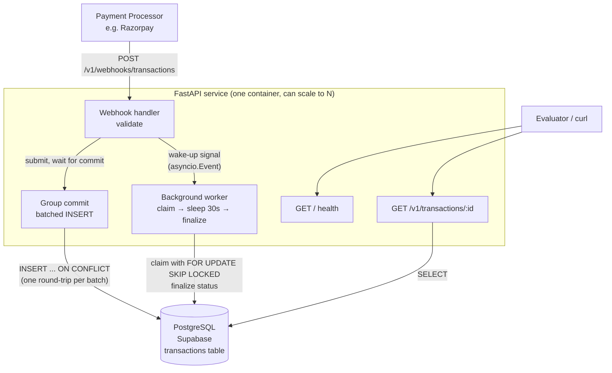
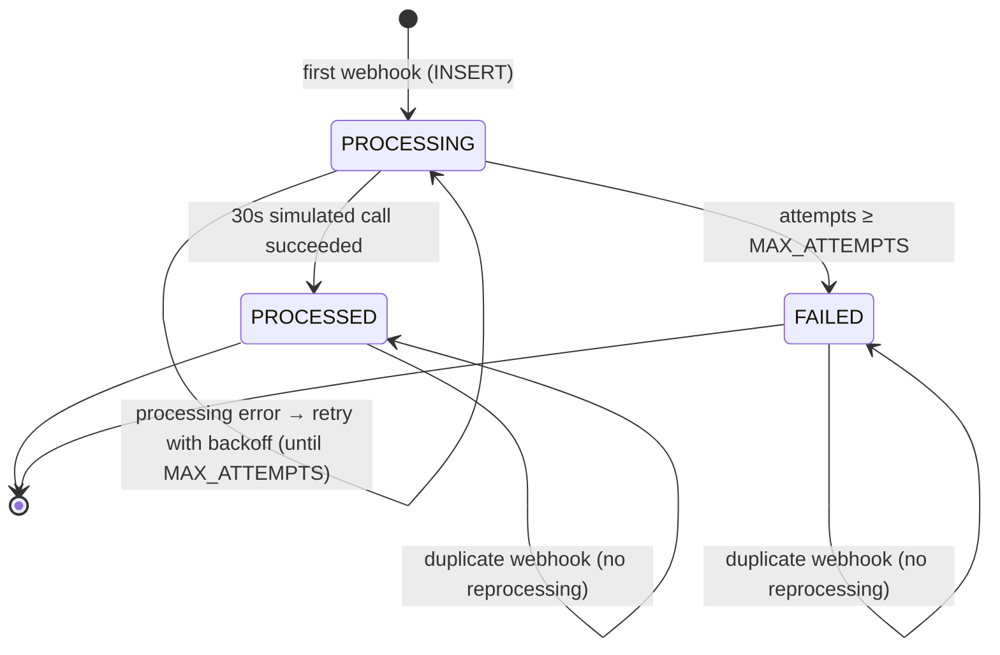
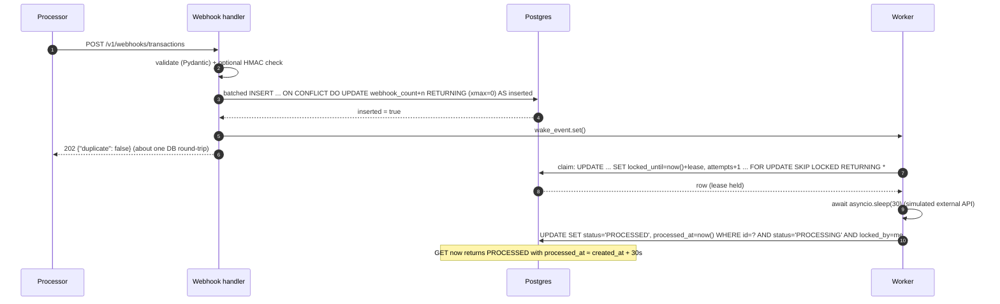
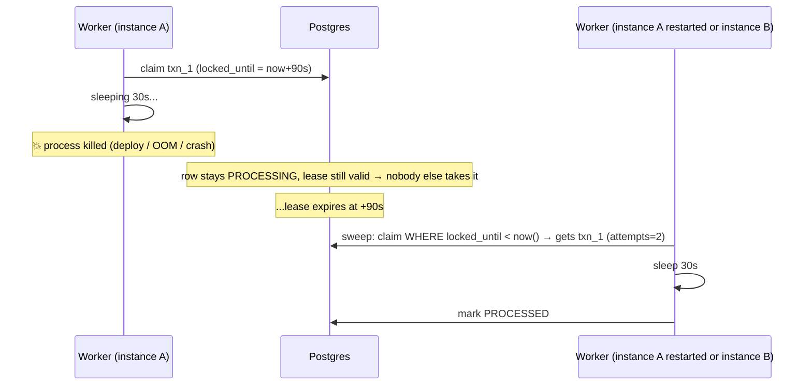
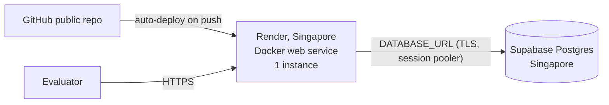

# Transaction Webhook Service — Technical Design

> Assessment: Full Stack Developer — Backend Task
> Status: Implemented, tested (60 integration tests) and deployed
> Stack: Python 3.11 · FastAPI · asyncpg · PostgreSQL (Supabase) · Docker · Render

---

## 1. Problem in one paragraph

A payment processor (e.g. Razorpay) calls our endpoint with a transaction webhook. It expects a **fast acknowledgement (202 in < 500 ms)**. It **retries** the same webhook if it does not get one, so we will see **duplicates**. The actual "processing" takes **~30 s** (simulating external API calls). We must **never lose a transaction**, **never process one twice**, and **store the final status and timings** in a cloud database.

The core idea of the design:

> **Persist first, acknowledge second, process later.**
> The webhook handler only does one fast, idempotent `INSERT`. A background worker
> picks rows out of the database (which doubles as a durable queue), waits 30 s,
> and marks them `PROCESSED`.

---

## 2. Requirements → Design traceability

Every line in the PDF, and where the design handles it.

| # | PDF requirement | How the design meets it | Verified by (User Guide §) |
|---|---|---|---|
| R1 | `POST /v1/webhooks/transactions` accepts the given body | FastAPI route + Pydantic model `TransactionWebhook` | S1, S8–S18 |
| R2 | `GET /` health check → `{"status":"HEALTHY","current_time":...}` | Lightweight route, no DB call, UTC ISO-8601 `Z` time | S0 |
| R3 | `GET /v1/transactions/{transaction_id}` returns status (array shape) | Route returns `[ {...} ]`; `404` if unknown | S1, S20 |
| R4 | Must return **202 Accepted** | Route `status_code=202` for new **and** duplicate webhooks | S1–S5 |
| R5 | Respond **within 500 ms regardless of processing complexity** | Handler does only one indexed `INSERT ... ON CONFLICT`; processing is never awaited in the request | S6, S28 |
| R6 | Body can be empty or simple ack | Returns `{"message":"accepted","transaction_id":..., "duplicate":bool}` | S1 |
| R7 | Process each transaction **after** receiving the webhook | Background worker started in app lifespan | S1 |
| R8 | Processing includes a **30-second delay** | `await asyncio.sleep(PROCESSING_DELAY_SECONDS)` (default 30) — non-blocking | S1 |
| R9 | Store final result in **persistent storage** | PostgreSQL (Supabase); `status`, `processed_at` updated | S1, S26 |
| R10 | **Idempotency** — duplicate `transaction_id` → one processed txn | `transaction_id` is the **PRIMARY KEY**; `ON CONFLICT DO UPDATE webhook_count+1`; worker guard on status | S2–S5, S19 |
| R11 | Handle duplicates **gracefully, no errors** | Duplicate returns 202 (not 409) | S2–S5 |
| R12 | Store status **and timing information** | `created_at`, `updated_at`, `processed_at`, `attempts` columns | S1 |
| SC1 | Single txn processed after ~30 s | Worker wake-up on insert + 1 s poll | S1 |
| SC2 | Duplicates → only one processed | PK + row lease + conditional final update | S2–S5, S34 |
| SC3 | Fast under processing load | Concurrency bounded by semaphore; sleep is async; handler independent of worker | S6, S28 |
| SC4 | Handles errors gracefully, **doesn't lose transactions** | Never 202 unless row committed; lease expiry recovers crashes; retries + `FAILED` terminal state | S25–S27, S29 |
| D1 | Public GitHub repo, README with run/test instructions + tech choices | README + these two docs | — |
| D2 | Public API deployed on cloud | Docker image on Render/Railway + Supabase Postgres | §11 |

---

## 3. Architecture



### Components

| Component | Responsibility | Why |
|---|---|---|
| **Webhook handler** | Validate body, (optionally) verify signature, submit to group commit, return 202 after the commit, ping the worker | Keeps the hot path to ~1 DB round-trip → well under 500 ms |
| **Group commit** (`IntakeBatcher`) | Writes all concurrently arriving webhooks in one `INSERT … ON CONFLICT` | With a cloud DB (~125 ms per round-trip) one insert per request can't keep up with bursts |
| **PostgreSQL table `transactions`** | Source of truth **and** the work queue | One system to operate; the insert *is* the enqueue, so "accepted but not queued" can't happen |
| **Background worker** (asyncio task in the same process) | Claims pending rows with a **lease**, sleeps 30 s, writes `PROCESSED` | No extra infra (Redis/Celery) for a 2–3 h task, yet durable because state lives in Postgres |
| **Sweeper** (same worker loop, every `POLL_INTERVAL`) | Re-claims rows whose lease expired (crash, restart, deploy) | This is what makes "doesn't lose transactions" true |
| **Query endpoint** | Read row, map to the response shape | Evaluator's way to see the outcome |
| **Health endpoint** | Liveness, no DB call | Must stay fast and must not flap when DB blips |

### Why not the alternatives?

| Option | Verdict | Reason |
|---|---|---|
| FastAPI `BackgroundTasks` / bare `asyncio.create_task` only | ❌ | Work lives only in memory. A restart/deploy during the 30 s loses it → fails SC4. (We still use an asyncio task, but it reads from the DB, not memory.) |
| Celery + Redis / RQ | ⚠️ Works, but | Two more moving parts to deploy and pay for; Redis ack + DB write is a dual-write (needs outbox to be correct). Overkill for this scope. Mentioned as the scale-up path. |
| AWS SQS + Lambda | ⚠️ Works, but | Dual-write problem again (DB + queue), more setup time, harder for evaluators to run locally. |
| **Postgres as queue (`SKIP LOCKED`)** | ✅ Chosen | Atomic: accept = persist = enqueue in one statement. Safe with many workers. Proven pattern (used by Oban, Que, graphile-worker, pg-boss). |

---

## 4. Data model

```sql
-- migrations/001_init.sql
CREATE TABLE IF NOT EXISTS transactions (
    transaction_id       TEXT PRIMARY KEY,                 -- idempotency key
    source_account       TEXT        NOT NULL,
    destination_account  TEXT        NOT NULL,
    amount               NUMERIC(18,2) NOT NULL CHECK (amount > 0),
    currency             CHAR(3)     NOT NULL,
    status               TEXT        NOT NULL DEFAULT 'PROCESSING'
                         CHECK (status IN ('PROCESSING','PROCESSED','FAILED')),

    -- timing information (R12)
    created_at           TIMESTAMPTZ NOT NULL DEFAULT now(), -- first webhook received
    updated_at           TIMESTAMPTZ NOT NULL DEFAULT now(),
    processed_at         TIMESTAMPTZ,                         -- NULL while processing

    -- reliability / observability
    attempts             INT         NOT NULL DEFAULT 0,
    locked_by            TEXT,                                -- worker id holding the lease
    locked_until         TIMESTAMPTZ,                         -- lease expiry
    next_attempt_at      TIMESTAMPTZ NOT NULL DEFAULT now(),  -- retry backoff
    last_error           TEXT,
    webhook_count        INT         NOT NULL DEFAULT 1,      -- how many times we received it
    payload_hash         TEXT        NOT NULL,                -- sha256 of canonical payload
    payload_mismatch     BOOLEAN     NOT NULL DEFAULT FALSE   -- duplicate id, different body
);

-- Worker scan: only pending rows, cheap partial index
CREATE INDEX IF NOT EXISTS ix_transactions_pending
    ON transactions (next_attempt_at)
    WHERE status = 'PROCESSING';
```

### Design notes

* **`transaction_id` as PRIMARY KEY** is the whole idempotency guarantee at the storage layer. Two concurrent inserts with the same id cannot both succeed — Postgres serialises them on the unique index.
* **`NUMERIC(18,2)`, never float.** `150.50` must stay `150.50`. In Python we use `Decimal`.
* **Status is a small closed set.** The PDF only shows `PROCESSING` and `PROCESSED`; we add `FAILED` as a terminal state so a poison transaction does not retry forever. (Documented deviation.)
* **Only one table.** An optional `webhook_events` audit table (every raw delivery) is a listed extension, skipped to keep the hot path to one write.

### Status state machine



---

## 5. API contract

### 5.1 `GET /` — health check

```json
200 OK
{ "status": "HEALTHY", "current_time": "2024-01-15T10:30:00Z" }
```

* No DB call (liveness). Keeps the endpoint fast and stops platform health checks from restarting the app when the DB has a short blip.
* Optional extra: `GET /health/ready` pings the DB (`SELECT 1`) and returns `503 {"status":"UNHEALTHY"}` on failure. Not required by the PDF.
* The PDF example has a trailing comma (invalid JSON). We return valid JSON.

### 5.2 `POST /v1/webhooks/transactions`

Request:

```json
{
  "transaction_id": "txn_abc123def456",
  "source_account": "acc_user_789",
  "destination_account": "acc_merchant_456",
  "amount": 1500,
  "currency": "INR"
}
```

Validation rules (Pydantic v2):

| Field | Rule | Failure |
|---|---|---|
| `transaction_id` | string, trimmed, 1–255 chars, pattern `^[A-Za-z0-9_\-:.]+$` | 422 |
| `source_account` | string, trimmed, 1–255 chars | 422 |
| `destination_account` | string, trimmed, 1–255 chars, **≠ source_account** | 422 |
| `amount` | JSON number (int or decimal), `> 0`, `≤ 10^12`, max 2 decimal places | 422 |
| `currency` | 3 letters, upper-cased on input (`inr` → `INR`); ISO-4217 format | 422 |
| extra fields | **ignored** (processors add fields over time; rejecting them would break us) | — |
| body size | ≤ 64 KB | 413 |
| content type | must be JSON | 422 |

Responses:

| Case | Code | Body |
|---|---|---|
| New transaction stored | **202** | `{"message":"accepted","transaction_id":"txn_…","duplicate":false}` |
| Duplicate (any current status) | **202** | `{"message":"accepted","transaction_id":"txn_…","duplicate":true}` |
| Invalid body | 422 | FastAPI validation error detail |
| Bad / missing signature (only if `WEBHOOK_SECRET` set) | 401 | `{"detail":"invalid signature"}` |
| Body too large | 413 | `{"detail":"payload too large"}` |
| DB unavailable / insert timed out | **503** | `{"detail":"temporarily unavailable, retry"}` |

> **Why 503 and not 202 when the DB is down?** A 202 means "we have it". If we say that
> without having committed the row, the transaction is lost forever, since the processor
> won't retry. 503 makes the processor retry later, which our idempotency then absorbs.
> This is the most important reliability rule in the service.

> **Why 4xx for invalid payloads?** Retrying a malformed payload will never succeed;
> 4xx tells the processor to stop. 5xx is reserved for "our fault, try again".

### 5.3 `GET /v1/transactions/{transaction_id}`

```json
200 OK
[
  {
    "transaction_id": "txn_abc123def456",
    "source_account": "acc_user_789",
    "destination_account": "acc_merchant_456",
    "amount": 150.50,
    "currency": "USD",
    "status": "PROCESSED",
    "created_at": "2024-01-15T10:30:00Z",
    "processed_at": "2024-01-15T10:30:30Z"
  }
]
```

* The PDF shows the response as an **array**. We follow that exactly (array with one element).
* Unknown id → `404 {"detail":"transaction not found"}`. (Alternative: `200 []`. We choose 404 because it is the conventional REST meaning; noted as a decision to confirm.)
* `amount` is serialised as a JSON **number** (not a string) from the stored `Decimal`: `1500` → `1500`, `150.50` → `150.5`. JSON numbers don't keep trailing zeros, so the value is exact even though the text differs. No float rounding happens anywhere.
* Timestamps: UTC, ISO-8601, `Z` suffix, second precision, matching the PDF.
* `processed_at` is `null` while `PROCESSING`.
* Internal columns (`attempts`, `locked_*`, `webhook_count`) are **not** exposed here; an optional `?debug=true` could show them for the demo.

---

### 5.4 Extras for the demo (not in the PDF)

| Endpoint | Purpose |
|---|---|
| `GET /dashboard` | Static HTML page (no build, no external assets): send webhooks, run scenarios, watch status live |
| `GET /v1/transactions?limit=1..200&status=` | Newest first, including `attempts`, `webhook_count`, `payload_mismatch`, `last_error`, `started_at` (= lease start), using index `ix_transactions_created_at` (migration 002) |
| `GET /v1/stats` | Counts per status, oldest pending, worker in-flight/concurrency, server time (the page uses it to correct the browser clock for progress bars) |

Like the status endpoint, these are unauthenticated "for testing". In production they would sit behind auth.

## 6. Request flows (step by step)

### 6.1 Happy path — single transaction



### 6.2 The hot-path SQL: group commit (one round-trip per batch)

With a cloud database every statement costs a network round-trip (measured: **~125 ms** from India to Supabase in Seoul). One insert per request would cap each connection at ~8 webhooks/s, and a burst of 50 would queue past 500 ms. So the handler doesn't write by itself. It hands the webhook to an **`IntakeBatcher`** (`app/intake.py`):

* A few flusher tasks (`INTAKE_FLUSHERS`, default 4) each take **everything queued** (up to 500) and commit it in **one** multi-row statement.
* Each request awaits its own future and gets its 202 **only after its row is committed**. The guarantee is unchanged; only the round-trips are shared.
* A batch of 50 costs the same ~130 ms as a batch of 1.

```sql
INSERT INTO transactions AS t
    (transaction_id, source_account, destination_account, amount, currency,
     payload_hash, webhook_count, payload_mismatch)
SELECT * FROM unnest($1::text[], $2::text[], $3::text[], $4::numeric[], $5::text[],
                     $6::text[], $7::int[], $8::bool[])
ON CONFLICT (transaction_id) DO UPDATE
    SET webhook_count    = t.webhook_count + EXCLUDED.webhook_count,
        payload_mismatch = t.payload_mismatch OR EXCLUDED.payload_mismatch
                           OR t.payload_hash <> EXCLUDED.payload_hash,
        updated_at       = now()
RETURNING t.transaction_id, (t.xmax = 0) AS inserted, t.status, t.payload_hash;
```

* `xmax = 0` is true only for a freshly inserted row → tells us *new* vs *duplicate* in the same statement.
* Duplicates **never** touch `status`, `amount`, `processed_at` → first write wins, no reprocessing.
* **Duplicates inside one batch** are folded in Python first (Postgres rejects `ON CONFLICT DO UPDATE` touching a row twice in one statement): one row with `webhook_count = n`; the first request is `duplicate:false`, the rest `true`; differing bodies set `payload_mismatch`.
* Ids are **sorted** inside each batch so concurrent batches lock rows in the same order and can't deadlock.
* The request waits at most `DB_WRITE_TIMEOUT_MS` (400 ms), then gets 503. If its batch commits after that anyway, that's the safe direction: the sender's retry is just a duplicate.

### 6.2.1 Three latency traps found when testing against Supabase

| Trap | Effect | Fix |
|---|---|---|
| asyncpg's default **connection reset on release** (`RESET ALL; UNLISTEN *; …`) | One extra round-trip per query, so every insert cost 2 RTT (250 ms) | Custom `reset` that only rolls back an abandoned transaction (we never set session state) |
| **Lazy / idle-closed connections** | A new TLS connection to Seoul took ~930 ms, so the first webhook after startup or a quiet spell timed out | The whole API pool is opened and **primed** (hot statement prepared) at startup; idle connections are never closed; a keepalive re-warms every 60 s |
| **App and DB in different regions** (first deploy: Render Ohio, Supabase Seoul) | 170 ms per DB call; under 20 concurrent clients, 53 of 200 webhooks hit the 400 ms budget and got 503 | Redeployed both in **Singapore**: ~5 ms server time, 0 of 200 failed. Found by comparing `GET /` (0.5 ms) with `/health/ready` (one `SELECT 1`, 170 ms) via the `X-Process-Time-Ms` header |

### 6.3 Duplicate webhooks

| When the duplicate arrives | Row state | What happens | Response |
|---|---|---|---|
| Same instant (concurrent) | being inserted | Postgres unique index serialises; one inserts, the other takes the `ON CONFLICT` branch | both 202, one `duplicate:true` |
| During the 30 s processing | `PROCESSING`, leased | `webhook_count+1`, worker unaffected | 202 `duplicate:true` |
| After processing | `PROCESSED` | `webhook_count+1`, nothing re-queued | 202 `duplicate:true` |
| After failure | `FAILED` | `webhook_count+1`, not re-queued (manual replay only) | 202 `duplicate:true` |
| Same id, **different body** | any | Original data kept; `payload_mismatch = true`; WARNING log | 202 `duplicate:true` |

> Same id + different payload is a conflict. We choose to accept it **without error**,
> because the PDF says duplicates must be handled "without errors", and **flag** it for investigation.
> Returning 409 is the alternative. We'd discuss this one in the review.

### 6.4 Worker loop

```python
# pseudo-code — app/worker.py
async def run(self):
    while not self.stopping:
        free = self.concurrency - len(self.in_flight)
        if free > 0:
            rows = await repo.claim_batch(worker_id, limit=free, lease=LEASE_SECONDS)
            for row in rows:
                self.spawn(self.process(row))        # bounded by concurrency
        # wake immediately on new webhook, or after POLL_INTERVAL for sweeps/retries
        await wait_for_event_or_timeout(self.wake, POLL_INTERVAL)

async def process(self, row):
    try:
        await processor.call_external(row)           # asyncio.sleep(30) [+ optional fault injection]
        await repo.mark_processed(row.id, worker_id) # guarded UPDATE
    except Exception as e:
        await repo.mark_retry_or_failed(row.id, worker_id, error=str(e))
```

Claim query (safe with N workers / N instances):

```sql
UPDATE transactions t
SET locked_by = $1,
    locked_until = now() + make_interval(secs => $3),
    attempts = attempts + 1,
    updated_at = now()
WHERE t.transaction_id IN (
    SELECT transaction_id FROM transactions
    WHERE status = 'PROCESSING'
      AND next_attempt_at <= now()
      AND (locked_until IS NULL OR locked_until < now())   -- free, or lease expired
    ORDER BY next_attempt_at
    LIMIT $2
    FOR UPDATE SKIP LOCKED
)
RETURNING t.*;
```

Finalize (guarded, so a worker whose lease was stolen can't overwrite):

```sql
UPDATE transactions
SET status = 'PROCESSED', processed_at = now(), updated_at = now(),
    locked_by = NULL, locked_until = NULL, last_error = NULL
WHERE transaction_id = $1 AND status = 'PROCESSING' AND locked_by = $2;
```

Retry / fail:

```sql
UPDATE transactions
SET status          = CASE WHEN attempts >= $3 THEN 'FAILED' ELSE 'PROCESSING' END,
    -- exponential backoff: 2 s, 4 s, 8 s ... capped at RETRY_MAX_SECONDS
    next_attempt_at = now() + make_interval(
                          secs => LEAST($5::float8, $4::float8 * power(2, attempts - 1))),
    last_error      = $6,
    locked_by       = NULL,
    locked_until    = NULL,
    updated_at      = now()
WHERE transaction_id = $1 AND status = 'PROCESSING' AND locked_by = $2
RETURNING status;
```

### 6.5 Crash / restart / deploy mid-processing



* **Graceful shutdown (SIGTERM)**: the lifespan hook stops claiming, cancels in-flight tasks, and **releases** their leases (clears `locked_by`/`locked_until` and undoes the interrupted attempt), so the next instance picks them up at once rather than after the lease expires.
* `LEASE_SECONDS` (default 90) must be > `PROCESSING_DELAY_SECONDS` (30) plus margin, or a healthy worker's job could be stolen. Enforced at startup.

### 6.6 Delivery semantics (be honest about this)

* **Webhook intake: exactly-once storage.** Guaranteed by the PK.
* **Processing: at-least-once execution, exactly-once *result*.** If a worker dies *after* the 30 s "external call" but *before* the final `UPDATE`, the call runs again on recovery. The final state is still written once (guarded update). In a real system the external call gets an **idempotency key = `transaction_id`**, so the downstream side dedupes too. This is the standard answer; exactly-once side effects across a network are not achievable without the downstream's cooperation.

---

## 7. Performance — meeting 500 ms under load

| Concern | Mitigation |
|---|---|
| Processing time leaking into the request | Request never awaits processing. It only sets an `asyncio.Event`. |
| 30 s sleep blocking the server | `asyncio.sleep` yields the event loop, so thousands of sleeps cost ~nothing. **Never `time.sleep`.** |
| Unbounded concurrency (memory, DB connections) | `WORKER_CONCURRENCY` (default 100) caps in-flight jobs. Excess rows simply wait in the table. |
| DB connection churn | `asyncpg` API pool (10) is fully opened and primed at startup and kept warm; the worker has its own pool (5) so a busy worker can't starve the handler. |
| Round-trip latency to a cloud DB | **Group commit** (§6.2): concurrent webhooks share one INSERT round-trip. |
| DB latency | DB in the **same region** as the app. Deployed: Render and Supabase both in **Singapore** (`ap-southeast-1`), ~1–5 ms per round-trip. Cross-region adds ~100–250 ms per round-trip (see §6.2.1). |
| Supabase pooler quirks | Using the **transaction pooler (port 6543)** means pgbouncer, which can't use prepared statements, so set `statement_cache_size=0` in asyncpg. Or use the session pooler / direct connection (5432). |
| Slow DB / timeouts | `wait_for(insert, 0.4s)` → 503. Fail fast and let the processor retry. |
| Cold starts on free hosting | Free tiers that sleep (Render free) take 30–60 s to wake, which blows the 500 ms budget. Use an always-on instance (Render Starter / Railway / Fly `min_machines_running=1`). |
| Throughput math | With concurrency 100 and a 30 s delay: ~200 txn/min per instance. A burst of 1000 is accepted instantly (all 202), then finishes in ~5 min. Raise concurrency or add instances to scale; `SKIP LOCKED` makes that safe. |

Measured:

| Setup | Result |
|---|---|
| Local Postgres, 2000 webhooks, ~4000 queued | 779 req/s, p99 171 ms, all 202 |
| **Supabase (Seoul) from India, ~125 ms RTT**, 2000 webhooks at 50 concurrent | **all 202, p50 216 ms, p99 272 ms**, zero timeouts |
| **Live deployment** (Render + Supabase, both Singapore), 200 webhooks at 20 concurrent | **all 202, server time p50 10 ms, p99 98 ms**; smoke test 17/17 |

On the live deployment, a single webhook takes ~5–10 ms of server time; the rest of what a client sees is network.

---

## 8. Security

* **Signature verification (optional, on when `WEBHOOK_SECRET` is set):** Razorpay sends `X-Razorpay-Signature = HMAC_SHA256(secret, raw_body)`. Compare with `hmac.compare_digest` on the **raw bytes** before parsing JSON. Off by default so evaluators can test with plain `curl`.
* **SQL injection:** only parameterised queries (`$1`, `$2`, ...).
* **Payload size cap** (64 KB) against memory abuse.
* **No secrets in code:** everything via env vars; `.env.example` in repo, `.env` git-ignored.
* **Query endpoint is public** because the PDF says it is "for testing". In production it would need auth. Noted.
* Logs mask account numbers (`acc_us***789`).

---

## 9. Configuration

| Env var | Default | Purpose |
|---|---|---|
| `DATABASE_URL` | — (required) | Postgres DSN (Supabase) |
| `PROCESSING_DELAY_SECONDS` | `30` | Simulated external call. Tests set `0`–`1`. |
| `WORKER_CONCURRENCY` | `100` | Max in-flight jobs per instance |
| `POLL_INTERVAL_SECONDS` | `1` | Sweep / retry check interval |
| `LEASE_SECONDS` | `90` | Must be > delay + margin |
| `MAX_ATTEMPTS` | `5` | Then `FAILED` |
| `DB_WRITE_TIMEOUT_MS` | `400` | Hot-path insert budget, then 503 |
| `INTAKE_FLUSHERS` / `INTAKE_MAX_BATCH` | `4` / `500` | Group-commit writers and max rows per batch |
| `DB_API_POOL_SIZE` / `DB_WORKER_POOL_SIZE` | `10` / `5` | Connections per instance (Supabase free tier allows ~60 direct) |
| `WEBHOOK_SECRET` | empty | Enables HMAC verification |
| `SIMULATED_FAILURE_RATE` | `0.0` | 0–1, fault injection for demoing retries |
| `LOG_LEVEL` | `INFO` | |

---

## 10. Project structure

```
confluence/
├── app/
│   ├── main.py           # FastAPI app, routes, lifespan (pools, migrations, warm-up, batcher, worker)
│   ├── config.py         # pydantic-settings
│   ├── db.py             # asyncpg pools, warm-up/keepalive, migrations
│   ├── schemas.py        # TransactionWebhook, TransactionOut, TransactionSummary, Stats, Health
│   ├── intake.py         # IntakeBatcher: group commit for webhook inserts
│   ├── repository.py     # all SQL: insert_batch, claim_batch, mark_processed, mark_retry_or_failed, get
│   ├── worker.py         # Worker class: loop, semaphore, wake event, graceful shutdown
│   ├── processor.py      # simulate_external_call (sleep + optional failure)
│   ├── security.py       # HMAC signature check, log masking
│   └── static/           # dashboard.html, how-it-works.html
├── migrations/
│   ├── 001_init.sql
│   └── 002_created_at_index.sql
├── tests/
│   ├── conftest.py       # real test Postgres, delay 0.5 s
│   ├── test_health.py
│   ├── test_webhook_validation.py
│   ├── test_idempotency.py      # sequential + concurrent duplicates
│   ├── test_processing.py       # PROCESSING → PROCESSED, timings
│   ├── test_reliability.py      # lease expiry recovery, retries, FAILED, 503 on DB down
│   ├── test_performance.py      # latency under load
│   └── test_dashboard.py        # dashboard, walkthrough, list/stats endpoints
├── .vscode/              # debug configurations
├── requests.http         # ready-made requests for VS Code REST Client
├── render.yaml           # Render blueprint
├── requirements-dev.txt  # test deps
├── scripts/
│   ├── smoke_test.sh     # curl walkthrough of the success criteria against any BASE_URL
│   └── load_test.py      # httpx async burst, prints p50/p95/p99
├── docs/
│   ├── 01-TECHNICAL-DESIGN.md   # this file
│   └── 02-USER-GUIDE.md
├── Dockerfile
├── docker-compose.yml    # app + local postgres for offline dev
├── requirements.txt
├── .env.example
└── README.md
```

---

## 11. Deployment



Live: https://transaction-webhook-sg.onrender.com (Render and Supabase both in Singapore, so every database call stays in-region).

1. Create a Supabase project **in the same region as the app host** (both are fixed at creation). The tables are created automatically at startup (`AUTO_MIGRATE=true`); you can also run `migrations/*.sql` in the SQL editor.
2. Push repo to GitHub (public).
3. Render → New Web Service → from repo → Docker. Set `DATABASE_URL` to the Supabase **session pooler** URL (the direct `db.*` host is IPv6-only, which Render can't reach). Plan: always-on (not free-sleeping).
4. Start command: `uvicorn app.main:app --host 0.0.0.0 --port $PORT --workers 1`.
   One process per container keeps behaviour simple. More capacity = more instances; `SKIP LOCKED` keeps them safe.
5. Run `scripts/smoke_test.sh https://<service>.onrender.com`.

---

## 12. Testing strategy

| Layer | What | Tooling |
|---|---|---|
| Unit | Validation rules, amount/currency normalisation, HMAC, serializer (2 dp, `Z` time) | pytest |
| Integration (real Postgres) | Insert / dup / mismatch, claim with `SKIP LOCKED` across 2 workers, lease expiry, retry → FAILED | pytest + a real Postgres, processing delay 0.5 s |
| API | All endpoints and status codes | `httpx.AsyncClient` + `ASGITransport` |
| Concurrency | 50 parallel identical webhooks → 1 row, `webhook_count=50`, processed once | `asyncio.gather` |
| Performance | 500 webhooks while 500 are processing → p99 < 500 ms | `scripts/load_test.py` |
| E2E on cloud | The PDF's 4 success criteria | `scripts/smoke_test.sh` |

---

## 13. How the evaluation and interview will likely go

**Phase 1: automated or manual testing of your public URL** (the 4 success criteria):

1. `GET /`: is it up?
2. Send one webhook, check `202` and timing, `GET` right away (`PROCESSING`), `GET` after ~30 s (`PROCESSED`, `processed_at - created_at ≈ 30 s`).
3. Send the same webhook 3–10 times (maybe in parallel). All `202`, one record, processed once.
4. Fire many webhooks quickly. Each response stays under 500 ms.
5. Possibly: bad payloads, unknown ids, a redeploy mid-processing.

**Phase 2: code and README review.** Clarity, structure, tests, and whether the README explains how to run and test plus the choices made.

**Phase 3: discussion.** Likely questions, with the short answers this design gives:

| Question | Answer |
|---|---|
| Why not `BackgroundTasks`? | In-memory, so lost on restart. The DB is our queue, so nothing is lost. |
| What if two identical webhooks arrive at the exact same ms? | PK unique index serialises them; `ON CONFLICT` makes the second a no-op. |
| What if the server crashes during the 30 s? | Lease expires, sweeper re-claims, and the row is processed. Graceful shutdown releases leases right away. |
| What if the DB is down when a webhook arrives? | 503, the processor retries, and idempotency absorbs the retry. We never 202 un-persisted data. |
| Can a transaction be processed twice? | Storage and final state: no. The simulated external call can repeat after a crash (at-least-once), so the real call would carry an idempotency key. |
| How do you scale? | Add instances or raise concurrency; `SKIP LOCKED` distributes work. Beyond ~1k jobs/s, move to SQS/Kafka with a transactional outbox. |
| Why Postgres over Redis queue? | Atomic accept-and-enqueue, one dependency, durable, queryable. |
| Same id, different payload? | First write wins, flagged `payload_mismatch`, logged. 409 is the alternative. |
| How do you guarantee < 500 ms? | One indexed write, pooled connection, same-region DB, 400 ms timeout giving a 503, always-on instance. |
| Monitoring in prod? | Metrics: webhook latency, queue depth (`count(*) WHERE status='PROCESSING'`), oldest pending age, FAILED count. Alert on growth. |
| Security? | HMAC signature on the raw body, parameterised SQL, size limits, auth on the query endpoint. |

---

## 14. Assumptions and decisions to confirm

1. `amount` is in **major units** (1500 = ₹1500.00). Razorpay actually sends paise (minor units); we store what we're given as `NUMERIC(18,2)`.
2. Unknown transaction on GET → **404** (vs `200 []`).
3. Duplicate with a different payload → **202 + flag** (vs 409).
4. `source_account == destination_account` → **422** (business rule we chose).
5. `FAILED` status added beyond the PDF's two statuses.
6. Lowercase currency is **normalised** to uppercase rather than rejected.
7. Signature verification is **off by default** so evaluators can use plain curl.

## 15. Future extensions (out of scope)

* `webhook_events` raw audit table and a replay endpoint for `FAILED` rows.
* Transactional outbox + SQS/Kafka for high scale.
* Prometheus `/metrics`, OpenTelemetry tracing.
* Auth on the query endpoint; rate limiting per source IP.
* Partitioning or archiving of old processed rows.
